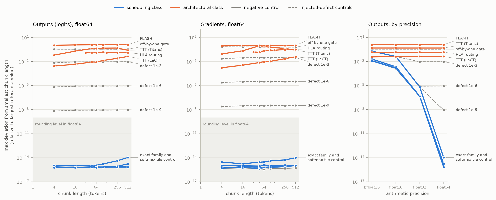

# When chunk size is a schedule and when it is a model

Chunked sequence architectures all expose a "chunk size", and the literature discusses it with one vocabulary.
It is two different things. For some architectures the chunkwise form is an exact re-association of one
recurrence, so the chunk size only schedules the computation. For others a named mechanism makes the chunk
boundary part of the function the layer computes, so the chunk size is a model hyperparameter.

This repository holds a test that tells the two apart **without training anything**, and the classification it
produces. Load one set of weights, feed one batch, run forward and backward at several chunk lengths, and
compare outputs and gradients.

**Status: Milestone 1 of a 12-week plan (target ICML 2027).** The test, its controls and the classification
exist and have been run on CPU and on one GPU. No model has been trained yet. Everything below is about what
a layer computes, not about quality.



*Deviation from the smallest chunk length for outputs (left) and gradients (middle) in float64, and the worst
output deviation at each precision (right). Scheduling-class layers sit at rounding level and fall with
precision. Architectural-class layers and injected defects do not move.*

## Result in one table

Reference implementations in this repository, 2-layer model, width 64, 512 tokens, float64. Deviation is the
worst difference from the smallest chunk length, relative to the largest reference value. Full tables,
per-chunk numbers and limits are in [docs/classification.md](docs/classification.md).

| Layer | Output deviation, float64 | float32 | Class | Why |
|---|---|---|---|---|
| Softmax attention at varying tile size (negative control) | 6e-16 | 4e-07 | scheduling | tiling |
| Gated linear attention | 2e-15 | 5e-07 | scheduling | re-association of the recurrence |
| DeltaNet | 8e-16 | 4e-07 | scheduling | re-association |
| Gated DeltaNet | 1e-14 | 6e-06 | scheduling | re-association |
| Mamba-2 SSD | 7e-16 | 4e-07 | scheduling | block decomposition of one operator |
| Test-time training, Titans-style | 0.48 | 0.48 | architectural | gradients frozen at the chunk start |
| Test-time training, LaCT-style | 0.043 | 0.043 | architectural | one fast-weight update per chunk |
| FLASH mixed chunk attention | 1.25 | 1.25 | architectural | quadratic within a chunk, linear across |
| HLA-style chunk routing | 0.14 | 0.14 | architectural | chunks are what the router acts on |

The decision does not rest on the size of the deviation. It rests on whether the deviation **scales with
precision**: a rounding artefact collapses by eight or nine orders of magnitude between float32 and float64,
and a structural difference does not move. That diagnostic is what separates a load-bearing chunk boundary
from a numerical artefact, and (given the mathematics) an intended boundary from a bug.

## How much to trust it

Controls, all passing on CPU:

- **Negative control.** Softmax attention evaluated with a streaming softmax at different tile sizes agrees
  to machine precision. If it did not, the harness would be wrong.
- **Sensitivity controls.** A provably exact kernel (Gated DeltaNet) with a deliberate defect is flagged as a
  bug down to a relative 1e-6 per chunk boundary. At 1e-9 the test reports "unresolved" and does not pass it.
- **Theory tests.** Each chunkwise form is checked against an independently written token-by-token loop, and
  each boundary mechanism against its limiting case (for example HLA with all routing weights at one is
  Gated DeltaNet at every chunk length). 62 tests, `uv run pytest`.

Limits, stated once here and in full in the classification document:

- The main tables use seeded random initialisations of a tiny model. The test was repeated on two small
  trained models (about 5M parameters) and on three publicly released checkpoints, with the same outcome
  for the scheduling class. No released checkpoint of an architectural-class model was tested.
- The reference layers were written for this project from the papers. HLA is written from the method section
  of its paper, not from released code.
- The mechanism statements are checked numerically. The chunkwise derivations have not yet been redone by hand.
- The decision thresholds on CPU were written down after a float64 smoke test had been seen, so they are not
  blind. The measured gaps are many orders of magnitude wide.

## The same test on trained weights

Both pilot models were trained (2,000 steps, about 5M parameters) and tested again. With the reference ops the
trained Gated DeltaNet model agrees across chunk lengths to 3e-14 in float64 and 3e-5 in float32 (scheduling);
the trained LaCT model differs by 0.02 to 0.17 at both precisions (architectural). On a GPU with the same
trained weights, the library's Gated DeltaNet kernel is about 1e-3 from the float64 recurrence under the TF32
default, 2e-6 with IEEE dot products, and 7e-3 to 9e-3 in bfloat16.

## The same test on publicly released checkpoints

Three released models, run through their authors' own kernels on real text: `state-spaces/mamba2-130m` with
the official `mamba_ssm` kernels, and `fla-hub/delta_net-1.3B-100B` and `fla-hub/gla-340M-15B` with
flash-linear-attention's. Each layer's kernel was also replayed on the activations it actually received,
against the float64 token-by-token recurrence.

| Released model | float32, Triton default | float32, IEEE | bfloat16 |
|---|---|---|---|
| Mamba-2 130M, one kernel call | 1.6e-03 from the recurrence | 4e-07 to 2e-05 | at the quantisation floor |
| Mamba-2 130M, whole model across chunk sizes | logits move up to 4e-03 | up to 6e-04 | up to 0.11; top token changes at up to 3.4% of positions |
| GLA 340M, whole model, chunked against recurrent | 8e-04 | 1e-06 | 9e-03; top token changes at 0.9% of positions |
| DeltaNet 1.3B, whole model, chunked against recurrent | kernel refuses float32 | kernel refuses float32 | up to 0.026; top token changes at 0.9% of positions |

So with real weights these three are scheduling-class, the TF32 gap is present in Mamba-2's official kernels
as well, and in bfloat16 the per-kernel rounding compounds across layers into visible changes in the model's
predictions when only the chunk size changes.

**That bfloat16 effect is ordinary rounding noise, not something special about chunking.** In a control, the
chunk size was held fixed and a random perturbation with the same per-element sizes was injected at every
layer in place of the real chunk-size difference. It changed the top-scoring token about as often as the real
chunk change (Mamba-2: 2.3% to 3.1% against 2.2% to 3.0%). Running in bfloat16 instead of float32 with the
chunk held fixed changed more (4.4%), and the same configuration run twice changed nothing.

## The same test on code other people ship

**Pure-PyTorch reference ops** in flash-linear-attention and LaCT (pinned commits, CPU) give the same split:
the delta-rule, gated delta-rule and scalar-decay ops agree to rounding, and TTT-Linear, Titans and the
official LaCT op are structural.

**Triton kernels** were run on two GPUs (NVIDIA A10 and H100 on Modal, Triton 3.9.0), with the same picture on both. They have no float64 path, so
each kernel is compared with a float64 oracle on the same inputs. What that showed:

1. **In bfloat16 and float16 the exact-family kernels sit within a few quantisation floors** of the oracle
   at every chunk size they accept. That is consistent with scheduling, but it is a weak bound: in bfloat16
   this test cannot see even a 1% per-boundary defect.
2. **With float32 inputs the chunked kernels are about 1e-3 from the exact recurrence** at every chunk size,
   while the recurrent kernels match it to 1e-6. The cause is TF32: Triton's dot product defaults to TF32 for
   float32 operands on tensor-core GPUs, and rerunning with `TRITON_F32_DEFAULT=ieee` brings the chunked
   kernels down to about 3e-7. The one exception, Gated DeltaNet at chunk 64, keeps a residual near 2e-4
   because that path requests TF32 explicitly for its triangular solve; with that also set to IEEE its outputs
   and gradients match to about 5e-7. So on
   these kernels "float32" is not float32 by default, and choosing the chunked form over the recurrent one
   costs about four orders of magnitude of numerical agreement. That matters for the planned precision study.
3. **The test-time-training kernels are chunk-dependent and match their per-chunk reference**, as expected.
4. **Kernels constrain which chunk sizes can be studied at all.** At the pinned commits, on the A10 (the H100
   accepts a little more, for example TTT-Linear at chunk 256 in bfloat16): the
   delta-rule kernels accept only 16, 32 and 64 (and DeltaNet refuses float32 input); the scalar-decay kernel
   needs a power of two and runs out of shared memory at 128 or 256 depending on the format; `chunk_gla` chooses its own size; TTT-Linear
   fits only chunk 16 with gradients; LaCT's fused kernel does not compile on this Triton version.

Two things found along the way that may be worth reporting upstream after confirmation: the library's
closed-form Titans op returns NaN gradients when the chunk does not divide the sequence, and large chunk sizes
can spend many minutes in Triton's compiler before failing.

## First training result: a small precision pilot

One question from the plan can be asked cheaply: for a layer whose chunkwise form is exact, does the chunk
length change the *trained* model once arithmetic is not exact? A 5.3M-parameter byte-level model on enwik8
with the library's Gated DeltaNet kernel was trained at chunk 16 and chunk 64, three seeds each, in three
arithmetics: bfloat16, float32 with Triton's TF32 default, and float32 with IEEE dot products. The criteria
were written down first ([docs/go_no_go.md](docs/go_no_go.md)).

**No chunk-length effect on final loss was detected at this scale, in any arithmetic.** At a fixed seed, chunk 64 against chunk 16 moved the final held-out
loss by at most 0.002 nats (bfloat16), 0.0004 (TF32) and 0.0008 (IEEE), against a seed-to-seed spread of about
0.004. The size of the difference does not track the size of the kernel's numerical error, which spans four
orders of magnitude across the three arithmetics.

**Training with these kernels is not reproducible run to run.** Three reruns of one configuration with the
same seed gave final losses spanning 0.003 to 0.004 nats, as wide as the spread across seeds. So the seed is
not what sets the noise here, and a same-seed comparison of two chunk lengths is no tighter than two reruns
of one.

Details and limits: [docs/pilot_precision.md](docs/pilot_precision.md). This is a small model trained for
minutes; it does not bound what happens at the scale of the planned study.

## Second training result: a small pilot on the architectural class

The other question: for a layer where the chunk boundary is part of the function, does chunk length change
trained quality? A 5.2M-parameter byte-level model whose blocks sum a fixed-window attention and the official
LaCT fast-weight op was trained at chunk 32, 128 and 512 on a 1024-byte context, plus chunk 1024 as an anchor
(one chunk means the op never updates its fast weights), five seeds each. Criteria were written down first
([docs/go_no_go_architectural.md](docs/go_no_go_architectural.md)).

**Verdict under the rule fixed beforehand: uninformative.** The rule treated runs as independent, and across
seeds the loss varies by 0.02 nats, more than the 0.018 gap between the best cell and the anchor.

**But the rule's noise model was wrong for this layer, and the data show a consistent pattern.** Within every
seed the loss rises with chunk length: chunk 512 is worse than chunk 32 in 5 of 5 seeds (mean +0.011 nats) and
the anchor is worse than chunk 32 in 5 of 5 (mean +0.018). This is a post-hoc reading and does not count as a
result; it is a specific prediction to test with new seeds and a paired test fixed in advance.

Chunk length also sets throughput: 41k tokens/s at chunk 32 against 206k with test-time training off, so the
equal-steps comparison above is far from an equal-wall-clock one. Details:
[docs/pilot_architectural.md](docs/pilot_architectural.md).

## Confirmatory pilot and the go/no-go decision

The post-hoc pattern above was tested on six seeds that had not been used, with a seed-paired test and the
combination rule fixed in advance ([docs/go_no_go_confirmatory.md](docs/go_no_go_confirmatory.md)), plus
same-seed reruns for a noise floor and a second rung at about 39M parameters.

**By the rule as written: no-go for the full paper.** The test needed a paired t above 3.365 (one-sided 1%)
and got 2.73 (p = 0.021). The registered test did not pass, which is not the same as showing no effect.

**What the rule did not use.** Chunk 512 was worse than chunk 32 in 6 of 6 new seeds (an exact sign test gives
p = 0.016, also above 1%), and in 3 of 3 at the larger size, which reuses seeds 5 to 7 and so is not an
independent set. The run-to-run floor of this model is 0.0013 nats; the smallest difference was 0.0057 and the
mean 0.015. The test fell short because one seed's difference, in the predicted direction, was four times the
others and inflated the variance. A paired t-test at 1% with six seeds was a fragile choice made before the
data. The verdict stands as registered; the facts are reported so a reader can weigh them.

**The wall-clock question is open and may point the other way.** Read against elapsed time, the same runs
favour the larger chunk: at about five and a half minutes the chunk-512 runs had reached a loss of 1.270 and
the chunk-32 runs 1.491, while at equal steps chunk 32 ends ahead. This is exploratory (the schedule was tied
to steps and the cells did not share one GPU model); see the last section of
[docs/pilot_confirmatory.md](docs/pilot_confirmatory.md).

The compute budget for the reduced grid, from throughput measured at 160M and 410M parameters on an H100, is
about $690 per seed per billion training tokens, two thirds of it chunk 32
([docs/compute_budget.md](docs/compute_budget.md)).

Everything in one place: [docs/go_no_go_decision.md](docs/go_no_go_decision.md).

## Reproduce

Requires [uv](https://docs.astral.sh/uv/). Everything on CPU runs in a few minutes.

```bash
uv sync
make control        # tests, the sweep, the controls, the classification, the spreadsheet
make figures        # regenerate the document and figure from the existing CSV
```

The first run clones flash-linear-attention and LaCT at pinned commits into `third_party/`.

The kernel tier needs a CUDA GPU. It is set up for [Modal](https://modal.com):

```bash
uv run modal run modal_app.py                                  # every kernel, default GPU
uv run modal run modal_released.py                             # three released checkpoints
CHUNK_GPU=H100 uv run modal run modal_app.py                   # another GPU; rows are keyed by GPU model
CHUNK_TRITON_F32=ieee uv run modal run modal_app.py --only fla_chunk_simple_gla,fla_chunk_gla,fla_chunk_gated_delta_rule --dtype float32
```

The last line is the ablation behind point 2 above; its rows are in `results/equivalence_kernels_ieee.csv`.

## Layout

| Path | Contents |
|---|---|
| `src/equivalence/test.py` | the sweep over chunk lengths and precisions; writes `results/equivalence.csv` |
| `src/equivalence/controls.py` | negative and sensitivity controls; exits 1 if they fail |
| `src/equivalence/precision_scaling.py` | the rule that separates rounding from a structural difference |
| `src/equivalence/classify.py` | writes `docs/classification.md`, the tables and figure one |
| `src/equivalence/matrix.py` | writes `architecture_matrix.xlsx` (architectures and literature) |
| `src/equivalence/archs/` | dtype-generic reference layers, chunk length as a call-time argument |
| `src/equivalence/library/` | the test applied to pinned pure-PyTorch third-party ops |
| `src/equivalence/kernels/` | the test applied to Triton kernels, with float64 oracles |
| `src/equivalence/released.py`, `modal_released.py` | the test on publicly released checkpoints through their authors' kernels |
| `modal_app.py` | runs the kernel tier on a Modal GPU, one isolated container per unit |
| `tests/theory/` | numerical checks of each proposition; `tests/unit/` checks the harness |
| `checkpoints/` | the fixed weights and batch (seeded, saved once, hashed in the CSV) |
| `results/` | every number in the documents: raw CSVs, summary tables, the figure |
| `docs/classification.md` | the result in full, generated from the CSVs |
| `docs/claims_audit.md` | every claim with its status and the file and column that support it |
| `src/pilot/`, `modal_pilot.py` | the small precision pilot: training loop around the library kernel, and its analysis |
| `docs/go_no_go*.md` | decision criteria, each fixed before its pilot ran, and `go_no_go_decision.md`, the outcome |
| `docs/pilot_*.md` | each pilot's outcome against its criteria |
| `docs/compute_budget.md`, `results/throughput_lact.csv` | measured training throughput and the cost of the reduced grid |

## Where this is going

| Milestone | Weeks | State |
|---|---|---|
| 1. Equivalence test and classification, before any training | 1-2 | test, controls, classification, matrix and kernel tier done; hand derivations, abstract and novelty memo not written |
| 2. Pilot, throughput model, joint quality model, go or no-go | 3-4 | three small pilots run against criteria fixed in advance; throughput measured at the planned sizes and the reduced grid costed; decision document written (no-go by the registered rule, with the evidence the rule did not use reported beside it); roadmap-scale pilots and the joint model not done |
| 3. Reduced grid, baselines, choice-space definition | 5-6 | not started |
| 4. Joint quality surface, precision study, wall-clock question | 7-8 | not started |
| 5. Ablations, mechanism, hardware condition | 9-10 | not started |
| 6. Manuscript and release | 11-12 | not started |

The plan itself ("the roadmap" in the documents here) is a separate document and is not part of this
repository.

Open items for Milestone 1: derive the chunkwise forms by hand; write the paragraph on why the HLA and FLASH
ablations do not transfer to an exact kernel; run the test on a released architectural-class model.

## Acknowledgements and licences

The test is applied to, and some reference layers follow, code and papers by others:
[flash-linear-attention](https://github.com/fla-org/flash-linear-attention) (MIT) and
[LaCT](https://github.com/a1600012888/LaCT) (MIT), both fetched at pinned commits and not redistributed here.
`src/equivalence/archs/lact.py` restates LaCT's `block_causal_lact_swiglu`, and the Mamba-2 layer follows the
`ssd_minimal` listing of the Mamba-2 paper. Papers are listed with verified arXiv identifiers in the
literature sheet of `architecture_matrix.xlsx`.

This repository is released under the MIT licence (see `LICENSE`).
