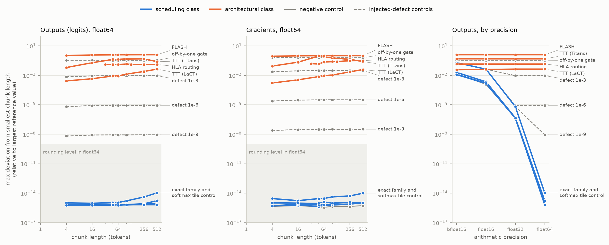

# Classification: is chunk length a schedule or part of the model?

Generated by `uv run python -m src.equivalence.classify` from `results/equivalence.csv`
(run 2026-11-18T03:49:51Z, torch 2.15.0, Darwin-arm64-cpu). Do not edit the tables by hand; rerun the script.

**Status of this document.** The measurements and the decision rule are mechanical. The one-line reasons
are statements of mechanism that each have a numerical check in `tests/theory/`, but the chunkwise
derivations behind them have not yet been re-derived by hand, which the roadmap asks for before the paper
leans on them. Read the "Scope and limits" section before quoting any row.

## What was run

One checkpoint per architecture and one batch, forward and backward at several chunk lengths, no training.

- Model: 2-layer language model, width 64, 2 heads, vocabulary 256,
  seeded random initialisation saved once to `checkpoints/` and reused (sha256 prefixes are in the CSV).
- Batch: 2 sequences of 512 tokens, fixed. Loss: next-token cross-entropy.
- "Outputs" are the logits; "gradients" are the gradient of the loss with respect to every weight.
- Deviation: the largest absolute difference from the reference chunk length (the smallest one the layer
  supports), divided by the largest absolute reference value. Gradients are concatenated over all weights.
- Precisions: bfloat16, float16, float32 and float64, the whole model cast to the format.
  float64 is the precision the classification is read at.
- Chunk lengths: 1, 4, 16, 64, 256 and 512 (the full sequence), plus 48 and 100, which do not divide the
  sequence and exercise the ragged last chunk. HLA starts at 16.

## Decision rule

The rule lives in `src/equivalence/precision_scaling.py`. Its thresholds were written down before the full
sweep ran, but after a float64 smoke test of the layers had been seen, so they are not blind to the data.
The measured gaps are wide enough that the classification does not depend on where exactly they sit.

With d32 and d64 the worst deviation over chunk lengths, outputs and gradients together:

- **ROUNDING** if d64 <= 1e-09 and d32/d64 >= 10000. The difference collapses when precision rises, so it
  is floating-point re-association. Class: **scheduling**.
- **STRUCTURAL** if d64 > 1e-09 and d32/d64 <= 100. The difference does not care about precision, so the
  chunk length changes the function. Class: **architectural** if a named mechanism makes the boundary
  load-bearing, **implementation bug** if the chunkwise form is provably exact.
- **INCONCLUSIVE** otherwise. Class: **unresolved**, to be investigated and never passed silently.

## Controls

All controls pass.

```
PASS  negative control softmax_tile float32: max deviation 4.41e-07 (limit 6.0e-05 = 1e+03 unit roundoffs)
PASS  negative control softmax_tile float64: max deviation 6.39e-16 (limit 1.1e-13 = 1e+03 unit roundoffs)
PASS  negative control softmax_tile classified scheduling (must be scheduling)
PASS  sensitivity control perturbed_leak_1e-3: classified 'implementation bug' (float64 deviation 9.26e-03, float32 9.26e-03)
PASS  sensitivity control perturbed_leak_1e-6: classified 'implementation bug' (float64 deviation 8.76e-06, float32 8.19e-06)
PASS  sensitivity control perturbed_leak_1e-9: classified 'unresolved' (float64 deviation 8.76e-09, float32 6.48e-06)
PASS  sensitivity control perturbed_stale_gate: classified 'implementation bug' (float64 deviation 3.39e-01, float32 3.39e-01)
```

| Architecture | Source | Expected from the mathematics | Output dev. f64 | Gradient dev. f64 | Output dev. f32 | Shrink f32 to f64 | Diagnostic | Class |
|---|---|---|---|---|---|---|---|---|
| `softmax_tile` | control | exact (tiling) | 6.4e-16 | 5.4e-16 | 4.4e-07 | 6.9e+08 | ROUNDING | **scheduling** |
| `perturbed_leak_1e-3` | control | exact (reassociation) | 9.3e-03 | 3.1e-02 | 9.3e-03 | 1.0e+00 | STRUCTURAL | **implementation bug** |
| `perturbed_leak_1e-6` | control | exact (reassociation) | 8.8e-06 | 3.2e-05 | 8.2e-06 | 8.9e-01 | STRUCTURAL | **implementation bug** |
| `perturbed_leak_1e-9` | control | exact (reassociation) | 8.8e-09 | 3.2e-08 | 6.5e-06 | 4.4e+02 | INCONCLUSIVE | **unresolved** |
| `perturbed_stale_gate` | control | exact (reassociation) | 3.4e-01 | 6.7e-01 | 3.4e-01 | 1.0e+00 | STRUCTURAL | **implementation bug** |

The injected-defect rows are a provably exact kernel (Gated DeltaNet, same checkpoint) with a deliberate
error: the carried state scaled by (1 + delta) at each chunk boundary, or the carried state missing the last
token's gate. "implementation bug" and "unresolved" both count as flagged. The delta = 1e-9 row marks the
sensitivity floor: in float64 the test still sees it, in float32 it is buried in rounding, and the rule
refuses to call it either way.

## Result: reference implementations

| Architecture | Source | Expected from the mathematics | Output dev. f64 | Gradient dev. f64 | Output dev. f32 | Shrink f32 to f64 | Diagnostic | Class |
|---|---|---|---|---|---|---|---|---|
| `gla` | arXiv 2312.06635 | exact (reassociation) | 1.7e-15 | 1.1e-15 | 4.7e-07 | 2.7e+08 | ROUNDING | **scheduling** |
| `deltanet` | arXiv 2406.06484 | exact (reassociation) | 8.0e-16 | 1.0e-15 | 4.3e-07 | 5.0e+08 | ROUNDING | **scheduling** |
| `gated_deltanet` | arXiv 2412.06464 | exact (reassociation) | 1.1e-14 | 9.9e-15 | 6.5e-06 | 1.3e+09 | ROUNDING | **scheduling** |
| `mamba2` | arXiv 2405.21060 | exact (reassociation) | 6.7e-16 | 1.3e-15 | 4.5e-07 | 5.4e+08 | ROUNDING | **scheduling** |
| `ttt_titans` | arXiv 2501.00663 | boundary (inner-loop boundary) | 4.8e-01 | 9.1e-01 | 4.8e-01 | 1.0e+00 | STRUCTURAL | **architectural** |
| `lact` | arXiv 2505.23884 | boundary (inner-loop boundary) | 4.3e-02 | 3.9e-02 | 4.3e-02 | 1.0e+00 | STRUCTURAL | **architectural** |
| `flash` | arXiv 2202.10447 | boundary (attention-pattern boundary) | 1.3e+00 | 1.0e+00 | 1.3e+00 | 1.0e+00 | STRUCTURAL | **architectural** |
| `hla` | arXiv 2610.05842 | boundary (routing boundary) | 1.4e-01 | 3.1e-01 | 1.4e-01 | 1.0e+00 | STRUCTURAL | **architectural** |

Why each one falls where it does:

- `softmax_tile`: Tile size only re-associates the softmax normaliser (streaming softmax). Pure kernel scheduling.
- `gla`: The chunkwise form is the recurrence S_t = diag(a_t) S_{t-1} + k_t^T v_t with the sums re-associated; chunk 1 is the recurrent form and one chunk is the parallel form.
- `deltanet`: Same recurrence, re-associated through the unit-triangular system for the pseudo-values (the WY / UT-transform representation of the product of Householder-like factors).
- `gated_deltanet`: As DeltaNet with a scalar gate folded into the cumulative decay; still a re-association.
- `mamba2`: The SSD block decomposition of one lower-triangular operator; scalar decay per head makes the off-diagonal blocks low rank.
- `ttt_titans`: Inner-loop boundary: every gradient in a chunk is taken at the memory frozen at the chunk start. Chunk 1 is online gradient descent (the delta rule when momentum and decay are off); a single chunk evaluates every gradient at the initial memory (Hebbian linear attention in the same limit).
- `lact`: Inner-loop boundary: apply-then-update, one fast-weight step and one weight renormalisation per chunk. The chunk sets how many updates happen and what each query can see; the last chunk is never used for an update, so a chunk of at least the sequence length means no test-time training at all.
- `flash`: Attention-pattern boundary: quadratic relu^2 attention inside a chunk, linear attention to earlier chunks, and the chunk size also normalises both paths. One chunk is pure quadratic attention.
- `hla`: Routing boundary: completed chunks are composed into affine maps and each query re-weights them with content-dependent sigmoid gates. With all gates at one it is Gated DeltaNet at every chunk length; with one chunk there is nothing to route and it is Gated DeltaNet again.
- `fla_delta_rule`: Library reference ops for the DeltaNet recurrence; recurrent loop against chunkwise.
- `fla_gated_delta_rule`: Library reference ops for the Gated DeltaNet recurrence; recurrent loop against chunkwise.
- `fla_simple_gla`: Library reference ops for scalar-decay linear attention; recurrent loop against chunkwise.
- `fla_ttt_linear`: Library TTT-Linear op: the mini-batch size is the inner-loop boundary.
- `fla_titans_sequential`: Library Titans op, token loop: `chunk_size` sets when the frozen memory is refreshed.
- `fla_titans_chunkwise`: Library Titans op, closed form per chunk: same boundary as the token loop.
- `fla_titans_loop_vs_closed_form`: Two implementations of the same Titans function at one chunk length. This is a consistency check of the library, not a chunk-length sweep.
- `lact_block_causal_swiglu`: The official LaCT op: apply-then-update with one fast-weight step per chunk.



*Figure 1. Deviation from the smallest chunk length for outputs (left) and gradients (middle) in float64,
and the worst output deviation at each precision (right). Scheduling-class layers sit at rounding level and
fall with precision; architectural-class layers and the larger injected defects do not move. Unlabelled
minor ticks are the chunk lengths that do not divide the sequence (48, 100) and HLA's 32 and 128.*

### Deviation at each chunk length, outputs, float64

| Architecture | chunk length: deviation from the reference (first entry) |
|---|---|
| `softmax_tile` | 1: 0 (identical), 4: 5.5e-16, 16: 5.5e-16, 64: 6.4e-16, 256: 6.4e-16, 512: 6.4e-16, 48: 6.4e-16, 100: 6.4e-16 |
| `gla` | 1: 0 (identical), 4: 6.9e-16, 16: 6.1e-16, 64: 6.9e-16, 256: 8.2e-16, 512: 1.7e-15, 48: 6.1e-16, 100: 6.9e-16 |
| `deltanet` | 1: 0 (identical), 4: 7.1e-16, 16: 6.2e-16, 64: 7.1e-16, 256: 8.0e-16, 512: 8.0e-16, 48: 7.1e-16, 100: 6.2e-16 |
| `gated_deltanet` | 1: 0 (identical), 4: 1.0e-15, 16: 9.4e-16, 64: 1.1e-15, 256: 4.1e-15, 512: 1.1e-14, 48: 1.1e-15, 100: 1.6e-15 |
| `mamba2` | 1: 0 (identical), 4: 5.9e-16, 16: 5.9e-16, 64: 5.9e-16, 256: 6.7e-16, 512: 6.7e-16, 48: 6.7e-16, 100: 6.7e-16 |
| `ttt_titans` | 1: 0 (identical), 4: 6.2e-02, 16: 1.9e-01, 64: 4.3e-01, 256: 4.8e-01, 512: 2.5e-01, 48: 4.1e-01, 100: 4.6e-01 |
| `lact` | 1: 0 (identical), 4: 2.7e-03, 16: 4.5e-03, 64: 8.5e-03, 256: 2.5e-02, 512: 4.3e-02, 48: 8.5e-03, 100: 1.3e-02 |
| `flash` | 1: 0 (identical), 4: 1.0e+00, 16: 1.2e+00, 64: 1.2e+00, 256: 1.2e+00, 512: 1.3e+00, 48: 1.2e+00, 100: 1.2e+00 |
| `hla` | 16: 0 (identical), 32: 1.3e-01, 64: 1.2e-01, 128: 1.3e-01, 256: 1.3e-01, 512: 1.3e-01, 48: 1.3e-01, 100: 1.4e-01 |
| `perturbed_leak_1e-3` | 1: 0 (identical), 4: 7.0e-03, 16: 8.8e-03, 64: 9.1e-03, 256: 9.3e-03, 512: 9.3e-03, 48: 9.1e-03, 100: 9.0e-03 |
| `perturbed_leak_1e-6` | 1: 0 (identical), 4: 6.5e-06, 16: 8.3e-06, 64: 8.6e-06, 256: 8.8e-06, 512: 8.8e-06, 48: 8.6e-06, 100: 8.5e-06 |
| `perturbed_leak_1e-9` | 1: 0 (identical), 4: 6.5e-09, 16: 8.3e-09, 64: 8.6e-09, 256: 8.8e-09, 512: 8.8e-09, 48: 8.6e-09, 100: 8.5e-09 |
| `perturbed_stale_gate` | 1: 0 (identical), 4: 3.4e-01, 16: 3.4e-01, 64: 3.4e-01, 256: 3.4e-01, 512: 3.4e-01, 48: 3.4e-01, 100: 3.4e-01 |

### Deviation at each chunk length, gradients, float64

| Architecture | chunk length: deviation from the reference (first entry) |
|---|---|
| `softmax_tile` | 1: 0 (identical), 4: 4.5e-16, 16: 5.4e-16, 64: 3.6e-16, 256: 4.5e-16, 512: 5.4e-16, 48: 4.0e-16, 100: 4.5e-16 |
| `gla` | 1: 0 (identical), 4: 5.0e-16, 16: 6.0e-16, 64: 5.7e-16, 256: 7.7e-16, 512: 1.1e-15, 48: 4.5e-16, 100: 6.2e-16 |
| `deltanet` | 1: 0 (identical), 4: 5.0e-16, 16: 7.7e-16, 64: 6.2e-16, 256: 7.7e-16, 512: 1.0e-15, 48: 6.5e-16, 100: 7.3e-16 |
| `gated_deltanet` | 1: 0 (identical), 4: 2.8e-15, 16: 1.7e-15, 64: 2.9e-15, 256: 5.3e-15, 512: 9.9e-15, 48: 2.8e-15, 100: 4.2e-15 |
| `mamba2` | 1: 0 (identical), 4: 1.0e-15, 16: 9.6e-16, 64: 1.3e-15, 256: 1.2e-15, 512: 1.0e-15, 48: 9.0e-16, 100: 9.6e-16 |
| `ttt_titans` | 1: 0 (identical), 4: 8.7e-02, 16: 2.2e-01, 64: 7.4e-01, 256: 4.2e-01, 512: 2.5e-01, 48: 9.1e-01, 100: 5.8e-01 |
| `lact` | 1: 0 (identical), 4: 1.6e-03, 16: 3.5e-03, 64: 9.5e-03, 256: 2.2e-02, 512: 3.9e-02, 48: 7.4e-03, 100: 1.1e-02 |
| `flash` | 1: 0 (identical), 4: 8.7e-01, 16: 9.6e-01, 64: 9.9e-01, 256: 1.0e+00, 512: 1.0e+00, 48: 9.8e-01, 100: 9.9e-01 |
| `hla` | 16: 0 (identical), 32: 1.5e-01, 64: 2.3e-01, 128: 2.5e-01, 256: 3.1e-01, 512: 3.1e-01, 48: 1.4e-01, 100: 2.5e-01 |
| `perturbed_leak_1e-3` | 1: 0 (identical), 4: 2.3e-02, 16: 2.9e-02, 64: 3.0e-02, 256: 3.0e-02, 512: 3.1e-02, 48: 3.0e-02, 100: 3.1e-02 |
| `perturbed_leak_1e-6` | 1: 0 (identical), 4: 2.4e-05, 16: 3.0e-05, 64: 3.2e-05, 256: 3.2e-05, 512: 3.2e-05, 48: 3.2e-05, 100: 3.2e-05 |
| `perturbed_leak_1e-9` | 1: 0 (identical), 4: 2.4e-08, 16: 3.0e-08, 64: 3.2e-08, 256: 3.2e-08, 512: 3.2e-08, 48: 3.2e-08, 100: 3.2e-08 |
| `perturbed_stale_gate` | 1: 0 (identical), 4: 6.7e-01, 16: 6.5e-01, 64: 6.2e-01, 256: 6.2e-01, 512: 6.2e-01, 48: 6.4e-01, 100: 6.2e-01 |

## Result: library code (pinned, pure-PyTorch paths only)

The same procedure applied at op level to code other people ship: fixed random inputs, the op's output, and
the gradient of a fixed linear probe with respect to every input. Sources:
flash-linear-attention at `cc4648a3b35c` and LaCT at `a648340f9798`, fetched to `third_party/`.
float32 rows are the code as shipped. Several of these ops cast to float32 internally, so the float64 rows
run a copy of the same source with those casts lifted to float64, used only for the diagnostic.

| Architecture | Source | Expected from the mathematics | Output dev. f64 | Gradient dev. f64 | Output dev. f32 | Shrink f32 to f64 | Diagnostic | Class |
|---|---|---|---|---|---|---|---|---|
| `fla_delta_rule` | fla@cc4648a fla/ops/delta_rule/naive.py | exact (reassociation) | 1.0e-15 | 2.3e-15 | 5.1e-07 | 5.6e+08 | ROUNDING | **scheduling** |
| `fla_gated_delta_rule` | fla@cc4648a fla/ops/gated_delta_rule/naive.py | exact (reassociation) | 4.0e-15 | 2.9e-15 | 9.2e-07 | 2.3e+08 | ROUNDING | **scheduling** |
| `fla_simple_gla` | fla@cc4648a fla/ops/simple_gla/naive.py | exact (reassociation) | 3.3e-15 | 2.6e-15 | 1.1e-06 | 3.3e+08 | ROUNDING | **scheduling** |
| `fla_ttt_linear` | fla@cc4648a fla/ops/ttt/naive.py | boundary (inner-loop boundary) | 2.3e+01 | 1.9e+01 | 2.3e+01 | 1.0e+00 | STRUCTURAL | **architectural** |
| `fla_titans_sequential` | fla@cc4648a fla/ops/titans/naive.py | boundary (inner-loop boundary) | 2.5e+00 | 5.8e+00 | 2.5e+00 | 1.0e+00 | STRUCTURAL | **architectural** |
| `fla_titans_chunkwise` | fla@cc4648a fla/ops/titans/naive.py | boundary (inner-loop boundary) | 3.3e+00 | 6.5e+00 | 3.3e+00 | 1.0e+00 | STRUCTURAL | **architectural** |
| `fla_titans_loop_vs_closed_form` | fla@cc4648a fla/ops/titans/naive.py | exact (reassociation) | 1.5e-15 | 1.3e-15 | 8.2e-07 | 7.6e+08 | ROUNDING | **implementations agree** |
| `lact_block_causal_swiglu` | lact@a648340 lact_llm/lact_model/ttt_operation.py | boundary (inner-loop boundary) | 1.8e-02 | 6.5e-01 | 1.8e-02 | 1.0e+00 | STRUCTURAL | **architectural** |

### Deviation at each variant, outputs, float32 as shipped

| Architecture | chunk length: deviation from the reference (first entry) |
|---|---|
| `fla_delta_rule` | recurrent 1: 0 (identical), chunkwise 1: 3.0e-07, chunkwise 4: 4.2e-07, chunkwise 16: 3.6e-07, chunkwise 64: 3.6e-07, chunkwise 256: 5.1e-07 |
| `fla_gated_delta_rule` | recurrent 1: 0 (identical), chunkwise 1: 2.6e-07, chunkwise 4: 2.6e-07, chunkwise 16: 2.9e-07, chunkwise 64: 2.6e-07, chunkwise 256: 9.2e-07, chunkwise 48: 2.9e-07, chunkwise 100: 3.9e-07 |
| `fla_simple_gla` | recurrent 1: 0 (identical), chunkwise 1: 2.1e-07, chunkwise 4: 2.7e-07, chunkwise 16: 2.1e-07, chunkwise 64: 2.7e-07, chunkwise 256: 1.1e-06, chunkwise 48: 2.1e-07, chunkwise 100: 2.8e-07 |
| `fla_ttt_linear` | mini-batch 1: 0 (identical), mini-batch 4: 1.5e+00, mini-batch 16: 3.8e+00, mini-batch 64: 7.6e+00, mini-batch 256: 2.3e+01, mini-batch 48: 5.7e+00 |
| `fla_titans_sequential` | sequential 1: 0 (identical), sequential 4: 8.6e-01, sequential 16: 1.3e+00, sequential 64: 1.8e+00, sequential 256: 2.5e+00, sequential 48: 2.0e+00 |
| `fla_titans_chunkwise` | chunkwise 4: 0 (identical), chunkwise 16: 1.8e+00, chunkwise 64: 2.6e+00, chunkwise 256: 3.3e+00, chunkwise 48: 2.9e+00 |
| `fla_titans_loop_vs_closed_form` | sequential 16: 0 (identical), chunkwise 16: 8.2e-07 |
| `lact_block_causal_swiglu` | apply-then-update 1: 0 (identical), apply-then-update 4: 5.0e-03, apply-then-update 16: 6.4e-03, apply-then-update 64: 1.8e-02, apply-then-update 256: 1.8e-02, apply-then-update 48: 9.6e-03 |

## Result: Triton kernels (GPU, run on Modal)

The same question asked of the kernels people train with. They compute in float32 or lower and have no
float64 path, so the precision ladder is replaced by a **float64 oracle**: every kernel output and input
gradient is compared with the token-by-token recurrence (exact family) or the reference definition at the
same chunk length (test-time training), evaluated in float64 on the same already-rounded inputs. The
oracles are checked against the libraries' own reference ops in `tests/theory/test_oracle_conventions.py`.

Rule (`src/equivalence/kernels/verdict.py`, constants fixed before the first GPU run): with the floor equal
to the larger of the output format's measured quantisation floor and 1000 float32 unit roundoffs,
**STRUCTURAL** if the cross-chunk deviation is at least 100 floors, **ROUNDING** if the oracle
deviation is at most 20 floors, **INCONCLUSIVE** otherwise. A kernel with a single runnable
variant gets no chunk-length verdict, only whether it matches its reference. Two sequence lengths are used,
1024 (every chunk size divides it) and 1000 (ragged tail); each cell is the worst over both and over all variants.

**Resolving power.** The sensitivity controls say how small a chunk-boundary defect this tier can see. In
float32 it flags a 1e-2 defect and misses 1e-4. In bfloat16 it misses even 1e-2: the reference chunkwise
algorithm itself, run in pure bfloat16, differs across chunk lengths by several percent. So a bfloat16
"scheduling" row means "no chunk effect larger than rounding in that format", which is a weak statement,
and the float32 and float16 rows are the informative ones.

### NVIDIA A10

torch 2.15.0+cu132, triton 3.9.0, CUDA 13.2, `torch.compile` disabled, run 2026-11-18T05:18:29Z.

Controls and yardstick (the reference chunkwise Gated DeltaNet from this repository, run on the same GPU in the same formats):

| Kernel | Input format | Variants that ran (label:chunk) | Cross-chunk dev., outputs | Cross-chunk dev., gradients | Oracle dev., outputs | Oracle dev., gradients | Definition's own cross-chunk dev. (f64) | Floor | Cross / floor | Oracle / floor | Diagnostic | Class |
|---|---|---|---|---|---|---|---|---|---|---|---|---|
| `gpu_softmax_tile` | float32 | torch scaled_dot_product_attention:0 tiled:16 tiled:64 tiled:256 | 6.1e-07 | 1.9e-06 | 5.4e-07 | 1.2e-06 | 0 (identical) | 6.0e-05 | 3.1e-02 | 2.0e-02 | ROUNDING | **scheduling** |
| `gpu_softmax_tile` | bfloat16 | torch scaled_dot_product_attention:0 tiled:16 tiled:64 tiled:256 | 5.1e-03 | 5.2e-03 | 6.0e-03 | 5.5e-03 | 0 (identical) | 2.9e-03 | 1.8e+00 | 2.1e+00 | ROUNDING | **scheduling** |
| `gpu_ref_gated_delta` | float32 | chunkwise:16 chunkwise:32 chunkwise:64 chunkwise:256 | 5.9e-07 | 7.5e-07 | 5.8e-07 | 6.3e-07 | 0 (identical) | 6.0e-05 | 1.3e-02 | 1.1e-02 | ROUNDING | **scheduling** |
| `gpu_ref_gated_delta` | bfloat16 | chunkwise:16 chunkwise:32 chunkwise:64 chunkwise:256 | 4.5e-02 | 4.5e-02 | 4.3e-02 | 4.5e-02 | 0 (identical) | 2.8e-03 | 1.6e+01 | 1.6e+01 | ROUNDING | **scheduling** |
| `gpu_perturbed_leak_1e-2` | float32 | chunkwise:16 chunkwise:32 chunkwise:64 | 1.1e-02 | 1.5e-02 | 1.1e-02 | 1.8e-02 | 0 (identical) | 6.0e-05 | 2.6e+02 | 3.0e+02 | STRUCTURAL | **implementation bug** |
| `gpu_perturbed_leak_1e-2` | bfloat16 | chunkwise:16 chunkwise:32 chunkwise:64 | 1.7e-02 | 2.7e-02 | 1.7e-02 | 2.1e-02 | 0 (identical) | 2.8e-03 | 1.0e+01 | 7.7e+00 | ROUNDING | **scheduling** |
| `gpu_perturbed_leak_1e-4` | float32 | chunkwise:16 chunkwise:32 chunkwise:64 | 1.1e-04 | 1.6e-04 | 1.1e-04 | 1.8e-04 | 0 (identical) | 6.0e-05 | 2.6e+00 | 3.0e+00 | ROUNDING | **scheduling** |
| `gpu_perturbed_leak_1e-4` | bfloat16 | chunkwise:16 chunkwise:32 chunkwise:64 | 1.1e-02 | 1.7e-02 | 1.2e-02 | 1.6e-02 | 0 (identical) | 2.8e-03 | 6.1e+00 | 5.8e+00 | ROUNDING | **scheduling** |

Injected defects flagged: `gpu_perturbed_leak_1e-2` in float32. **Not flagged** (the test cannot see them at this precision): `gpu_perturbed_leak_1e-2` in bfloat16, `gpu_perturbed_leak_1e-4` in float32, `gpu_perturbed_leak_1e-4` in bfloat16.

Kernels:

| Kernel | Input format | Variants that ran (label:chunk) | Cross-chunk dev., outputs | Cross-chunk dev., gradients | Oracle dev., outputs | Oracle dev., gradients | Definition's own cross-chunk dev. (f64) | Floor | Cross / floor | Oracle / floor | Diagnostic | Class |
|---|---|---|---|---|---|---|---|---|---|---|---|---|
| `fla_chunk_delta_rule` | float32 | fused_recurrent:1 | 0 (identical) | n/a | 2.8e-07 | 3.9e-07 | 0 (identical) | 6.0e-05 | 0 (identical) | 6.5e-03 | ONE VARIANT | **single variant: matches its reference** |
| `fla_chunk_delta_rule` | bfloat16 | fused_recurrent:1 chunk:16 chunk:32 chunk:64 | 5.1e-03 | 1.1e-02 | 5.3e-03 | 7.7e-03 | 0 (identical) | 2.6e-03 | 4.0e+00 | 3.0e+00 | ROUNDING | **scheduling** |
| `fla_chunk_delta_rule` | float16 | fused_recurrent:1 chunk:16 chunk:32 chunk:64 | 6.4e-04 | 1.3e-03 | 6.6e-04 | 8.4e-04 | 0 (identical) | 3.3e-04 | 4.0e+00 | 2.6e+00 | ROUNDING | **scheduling** |
| `fla_chunk_gated_delta_rule` | float32 | fused_recurrent:1 chunk:16 chunk:32 chunk:64 | 1.9e-03 | n/a | 1.9e-03 | 1.8e-03 | 0 (identical) | 6.0e-05 | 3.2e+01 | 3.2e+01 | INCONCLUSIVE | **unresolved** |
| `fla_chunk_gated_delta_rule` | bfloat16 | fused_recurrent:1 chunk:16 chunk:32 chunk:64 | 5.6e-03 | n/a | 6.4e-03 | 6.2e-03 | 0 (identical) | 2.8e-03 | 2.0e+00 | 2.3e+00 | ROUNDING | **scheduling** |
| `fla_chunk_simple_gla` | float32 | fused_recurrent:1 chunk:16 chunk:32 chunk:64 chunk:128 | 1.7e-03 | 1.6e-03 | 1.7e-03 | 1.6e-03 | 0 (identical) | 6.0e-05 | 2.8e+01 | 2.8e+01 | INCONCLUSIVE | **unresolved** |
| `fla_chunk_simple_gla` | bfloat16 | fused_recurrent:1 chunk:16 chunk:32 chunk:64 chunk:128 chunk:256 | 6.3e-03 | 5.8e-03 | 4.5e-03 | 4.3e-03 | 0 (identical) | 2.9e-03 | 2.2e+00 | 1.5e+00 | ROUNDING | **scheduling** |
| `fla_chunk_gla` | float32 | fused_recurrent:1 chunk (size fixed by the kernel):64 | 1.5e-03 | 1.6e-03 | 1.5e-03 | 1.6e-03 | 0 (identical) | 6.0e-05 | 2.6e+01 | 2.6e+01 | INCONCLUSIVE | **unresolved** |
| `fla_chunk_gla` | bfloat16 | fused_recurrent:1 chunk (size fixed by the kernel):64 | 3.7e-03 | 7.1e-03 | 3.8e-03 | 3.9e-03 | 0 (identical) | 3.4e-03 | 2.1e+00 | 1.2e+00 | ROUNDING | **scheduling** |
| `fla_chunk_ttt_linear` | float32 | chunk:16 chunk:64 | 2.2e+00 | n/a | 4.3e-07 | 2.1e-04 | 2.2e+00 | 6.0e-05 | 3.8e+04 | 3.5e+00 | STRUCTURAL | **architectural** |
| `fla_chunk_ttt_linear` | bfloat16 | chunk:16 chunk:64 | 2.2e+00 | n/a | 1.0e-02 | 8.9e-03 | 2.3e+00 | 3.2e-03 | 7.0e+02 | 3.3e+00 | STRUCTURAL | **architectural** |
| `fla_fused_chunk_ttt_linear` | float32 | fused_chunk:16 | 0 (identical) | n/a | 9.1e-07 | 2.1e-04 | 0 (identical) | 6.0e-05 | 0 (identical) | 3.5e+00 | ONE VARIANT | **single variant: matches its reference** |
| `fla_fused_chunk_ttt_linear` | bfloat16 | fused_chunk:16 fused_chunk:64 | 2.2e+00 | n/a | 8.5e-03 | 8.9e-03 | 2.3e+00 | 3.2e-03 | 7.1e+02 | 2.8e+00 | STRUCTURAL | **architectural** |
| `lact_block_causal_swiglu_autocast` | bfloat16 | apply-then-update:64 apply-then-update:256 apply-then-update:1024 | 3.0e-02 | 5.6e-01 | 6.1e-03 | 6.1e-03 | 3.0e-02 | 2.2e-03 | 2.6e+02 | 2.8e+00 | STRUCTURAL | **architectural** |
| `lact_fused_triton_kernel` | bfloat16 | fused:1024 | 0 (identical) | n/a | 4.6e-03 | 4.8e-03 | 0 (identical) | 2.2e-03 | 0 (identical) | 2.2e+00 | ONE VARIANT | **single variant: matches its reference** |

Variants a kernel refused, or that did not finish. These are recorded on purpose: what a kernel permits on a
given GPU bounds any chunk-length sweep. "Input aborted" means the container was stopped from outside while
the variant was still compiling; in an earlier run the same variants ran into the 25-minute cap.

| Kernel | Input format | Refused (label:chunk) | Error |
|---|---|---|---|
| `fla_chunk_delta_rule` | float32 | chunk:16 chunk:32 chunk:64 chunk:128 | AssertionError: ChunkDeltaRuleFunction does not support float32. Please use bfloat16. |
| `fla_chunk_delta_rule` | bfloat16 | chunk:128 | ValueError: 'chunk_size' must be 16, 32, or 64, got 128. |
| `fla_chunk_delta_rule` | float16 | chunk:128 | ValueError: 'chunk_size' must be 16, 32, or 64, got 128. |
| `fla_chunk_gated_delta_rule` | float32 | chunk:128 | ValueError: 'chunk_size' must be 16, 32, or 64 for Gated Delta Rule, got 128. |
| `fla_chunk_gated_delta_rule` | bfloat16 | chunk:128 | ValueError: 'chunk_size' must be 16, 32, or 64 for Gated Delta Rule, got 128. |
| `fla_chunk_simple_gla` | float32 | chunk:256 chunk:48 | OutOfResources: out of resource: shared memory, Required: 327680, Hardware limit: 101376. Reducing block sizes or 'num_stages' may help. / ValueError: 'chunk_size' must be a power of 2, got 48. |
| `fla_chunk_simple_gla` | bfloat16 | chunk:48 | ValueError: 'chunk_size' must be a power of 2, got 48. |
| `fla_chunk_ttt_linear` | float32 | chunk:256 | did not return within 1500s or the container died (RemoteError: Input aborted due to internal failure (e.g. preemption). Retries are disabled) |
| `fla_chunk_ttt_linear` | bfloat16 | chunk:256 | OutOfResources: out of resource: shared memory, Required: 163840, Hardware limit: 101376. Reducing block sizes or 'num_stages' may help. |
| `fla_fused_chunk_ttt_linear` | float32 | fused_chunk:64 fused_chunk:256 | OutOfResources: out of resource: shared memory, Required: 131592, Hardware limit: 101376. Reducing block sizes or 'num_stages' may help. / did not return within 1500s or the container died (RemoteError: Input aborted due to internal failure (e.g. preemption). Retries are disabled) |
| `fla_fused_chunk_ttt_linear` | bfloat16 | fused_chunk:256 | did not return within 1500s or the container died (RemoteError: Input aborted due to internal failure (e.g. preemption). Retries are disabled) |
| `lact_fused_triton_kernel` | bfloat16 | fused:64 fused:256 | CompilationError: at 24:10: / BT: tl.constexpr, / ): / # 2D Block tiling: / # Grid y-axis is T // BT, Grid x-axis is B / i_b = tl.program_id(0) / i_t  |

Forward only (no backward pass available, so no gradient comparison): `fla_chunk_gated_delta_rule` (float32): fused_recurrent:1; `fla_chunk_gated_delta_rule` (bfloat16): fused_recurrent:1; `fla_chunk_simple_gla` (float32): chunk:128; `fla_chunk_simple_gla` (bfloat16): chunk:256; `fla_chunk_ttt_linear` (float32): chunk:64; `fla_chunk_ttt_linear` (bfloat16): chunk:64; `fla_fused_chunk_ttt_linear` (bfloat16): fused_chunk:64.

Inputs with an all-zero gradient in every variant that ran (for LaCT this is expected when the only variant is a chunk of at least the sequence length, which never updates the fast weights): `lact_fused_triton_kernel` (bfloat16): k lr0 lr1 lr2 v.

### What the kernel tier adds

1. **In float32 the chunked kernels are about 1e-3 from the exact recurrence; the recurrent kernels are not.**
   With float32 inputs the `fused_recurrent_*` kernels match the float64 oracle to float32 rounding, while
   `chunk_gated_delta_rule`, `chunk_simple_gla` and `chunk_gla` sit near 1e-3 from it at every chunk size.
   That is four orders of magnitude above float32 rounding and well below a structural difference, which is
   why the rule returns INCONCLUSIVE for them.
   Read with point 2, those INCONCLUSIVE rows are a precision effect of the kernel's default arithmetic and
   not a chunk boundary: the classification of these architectures as scheduling stands.
2. **The cause is TF32: switching the dot products to IEEE removes it.** On a GPU with tensor cores Triton's `tl.dot`
   defaults to TF32 for float32 operands (its documentation, Triton 3.9.0: "For devices that do have
   tensor cores, the default precision is tf32"). The chunked kernels use `tl.dot`; the recurrent ones do
   not. At the pinned commit the delta-rule kernels force IEEE in most dot products but refuse float32 input
   outright, the gated delta-rule forward kernel explicitly selects TF32 for its triangular solve, and the
   scalar-decay and shared chunk kernels leave the default. Triton exposes `TRITON_F32_DEFAULT=ieee`;
   `CHUNK_TRITON_F32=ieee uv run modal run modal_app.py --only ...` reruns the kernels that way.
   Rerunning the float32 kernels with `TRITON_F32_DEFAULT=ieee` (worst output deviation from the float64 oracle over both sequence lengths):

| Kernel | Variant:chunk | Triton default (TF32) | IEEE |
|---|---|---|---|
| `fla_chunk_gated_delta_rule` | fused_recurrent:1 | 3.8e-07 | 3.8e-07 |
| `fla_chunk_gated_delta_rule` | chunk:16 | 1.9e-03 | 3.0e-07 |
| `fla_chunk_gated_delta_rule` | chunk:32 | 1.9e-03 | 3.6e-07 |
| `fla_chunk_gated_delta_rule` | chunk:64 | 1.8e-03 | 1.7e-04 |
| `fla_chunk_simple_gla` | fused_recurrent:1 | 4.9e-07 | 4.9e-07 |
| `fla_chunk_simple_gla` | chunk:16 | 1.6e-03 | 3.0e-07 |
| `fla_chunk_simple_gla` | chunk:32 | 1.6e-03 | 3.1e-07 |
| `fla_chunk_simple_gla` | chunk:64 | 1.7e-03 | 4.2e-07 |
| `fla_chunk_gla` | fused_recurrent:1 | 1.3e-06 | 1.3e-06 |
| `fla_chunk_gla` | chunk:64 | 1.5e-03 | 5.0e-07 |

   The recurrent kernels are unchanged, as they have no dot products. The chunked kernels fall to float32 rounding, with one exception: `chunk_gated_delta_rule` at chunk 64 keeps a residual about three orders of magnitude above rounding. At chunk 64 that kernel takes a separate fused path that requests TF32 explicitly for its triangular solve, which the environment switch does not override. That is the source: with the solve also set to IEEE (done inside the precision pilot's containers, `results/pilot_precision.csv`), the forward pass at chunk 64 is 3.3e-07 from the float64 recurrence. Gradients were not compared in that configuration.
3. **The feasible chunk sizes are set by the kernel, the GPU and the Triton version together.** See the
   refusals table: a fixed list of sizes for the delta-rule kernels, powers of two for the scalar-decay
   kernel, no choice at all for `chunk_gla`, block sizes that exceed this GPU's shared memory for the
   scalar-decay and TTT-Linear kernels, and a LaCT fused kernel that no longer compiles because it uses
   block pointers, which this Triton version has removed.
4. **Large chunk sizes are slow before they fail.** A kernel that tiles a whole chunk has to be compiled
   for each new chunk size, and compile time grows quickly with the block. Stack dumps of the units that
   went quiet were all inside Triton's compiler (`make_llir`, `make_ptx`) under the autotuner, not in GPU
   execution. The first runs here made this worse by giving the containers Modal's default fractional CPU.

## Low precision (descriptive only; this is what the precision study in Milestones 2 and 4 has to measure)

| Architecture | Class | Output dev. bfloat16 | Output dev. float16 | Output dev. float32 |
|---|---|---|---|---|
| `gla` | **scheduling** | 2.0e-02 | 2.2e-03 | 4.7e-07 |
| `deltanet` | **scheduling** | 1.3e-02 | 1.6e-03 | 4.3e-07 |
| `gated_deltanet` | **scheduling** | 1.9e-01 | 4.2e-02 | 6.5e-06 |
| `mamba2` | **scheduling** | 1.2e-02 | 1.5e-03 | 4.5e-07 |
| `ttt_titans` | **architectural** | 4.8e-01 | 4.8e-01 | 4.8e-01 |
| `lact` | **architectural** | 3.7e-02 | 4.0e-02 | 4.3e-02 |
| `flash` | **architectural** | 1.2e+00 | 1.3e+00 | 1.3e+00 |
| `hla` | **architectural** | 1.4e-01 | 1.4e-01 | 1.4e-01 |

For the scheduling class these are pure rounding effects, and they are not small in 16-bit arithmetic: the
function is the same, the computed numbers are not. This is the whole model cast to the format, including
recurrent states, which is harsher than mixed-precision training where states and accumulators are often
kept in float32. It says the precision study is worth running; it does not say what it will find.

## Things the test turned up that need a decision

1. **Kernel constraint on chunk length.** In flash-linear-attention at the pinned commit, `chunk_delta_rule`
   and `chunk_gated_delta_rule` accept only chunk sizes 16, 32 and 64, `chunk_simple_gla` requires a power
   of two, and `chunk_gla` sets its chunk size internally. For the scheduling class the "largest chunk the
   kernel permits" is therefore 64 in the delta-rule kernels, which bounds the precision study's sweep.
2. **Non-finite gradients in the library Titans closed form with a ragged tail.** `chunk_titans_linear`
   (`fla/ops/titans/naive.py`) returns finite outputs but NaN gradients with respect to `eta` and `alpha`
   whenever the sequence length is not a multiple of the chunk size (checked: T=256 with chunk 48, T=250 with
   chunk 64; T=240 with chunk 48 is fine). The token-loop version is finite in the same cases. A likely cause,
   from reading the code and not isolated further: the padded gates are zero and the closed form works in
   log space. This looks like a defect in the reference op and not a design choice; confirm before
   reporting it upstream.
3. **Titans token loop and closed form agree** at a fixed chunk length to rounding level when the length
   divides the sequence (`fla_titans_loop_vs_closed_form`), so the chunk dependence of that op is the
   intended inner-loop boundary and not an artefact of one of its two implementations.
4. **LaCT never uses the final chunk for an update**, and a chunk length of at least the sequence length
   disables test-time training entirely (verified in `tests/theory/test_boundary_family.py`). Any sweep that
   includes chunk >= context compares against a layer with a static MLP in place of the fast weights.

### Non-finite rows

| tier | architecture | dtype | status | rows |
|---|---|---|---|---|
| library | fla_titans_chunkwise | float32 | non-finite gradient | 1 |
| library | fla_titans_chunkwise | float64 | non-finite gradient | 1 |
| reference | deltanet | float16 | non-finite gradient | 8 |
| reference | gated_deltanet | float16 | non-finite gradient | 8 |
| reference | hla | float16 | non-finite gradient | 8 |
| reference | lact | float16 | non-finite gradient | 8 |
| reference | perturbed_leak_1e-3 | float16 | non-finite gradient | 8 |
| reference | perturbed_leak_1e-6 | float16 | non-finite gradient | 8 |
| reference | perturbed_leak_1e-9 | float16 | non-finite gradient | 8 |
| reference | perturbed_stale_gate | float16 | non-finite gradient | 8 |
| reference | ttt_titans | float16 | non-finite gradient | 8 |

The float16 backward pass is non-finite at every chunk length, the reference one included, in exactly the layers that L2-normalise their keys; this is consistent with float16's narrow exponent range and has not been isolated further. It is unrelated to chunking. Outputs in float16 are finite and are reported; bfloat16, the format mixed-precision training uses, is finite throughout.


## Scope and limits

- **Implementations, not architectures in general.** The reference tier is code written for this project
  from the papers. The library and kernel tiers cover the pinned commits of flash-linear-attention and LaCT
  on the GPUs named above, with `torch.compile` disabled. The official Mamba-2 kernels (`mamba_ssm`) are not
  covered; `chunk_simple_gla` is the same scalar-decay recurrence but a different kernel.
- **Random initialisation.** The checkpoint is a seeded initialisation, not a trained model. Whether chunk
  length changes the function does not depend on the weights for the mechanisms above, but the *size* of
  the rounding deviation does (gates near one, long effective memory). Repeat on a trained checkpoint
  before quoting magnitudes.
- **HLA is written from the method section of the paper**, not from released code, and is labelled
  HLA-style. The inference-time gate threshold and the training regulariser are not part of the test.
- **FLASH** follows the paper's pseudo-code with one substitution: a fixed-size table of relative-position
  biases so the parameter count does not depend on the chunk length.
- **Small.** Width 64, 2 layers, 512 tokens. Enough to decide the class; not evidence about scale.
- **The class label for a structural difference rests on the mathematical prior.** The test decides whether
  chunk length changes the function. Calling that architectural instead of a bug requires knowing that the
  mechanism is intended, which is the reason column and the theory tests, and ultimately the hand derivation.
