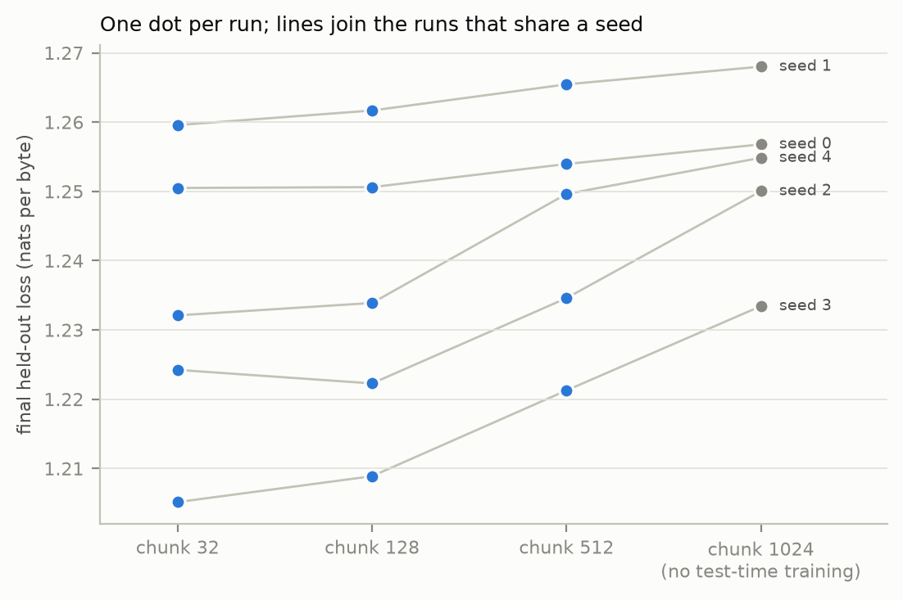

# Small pilot on the architectural class

Generated by `uv run python -m src.pilot.analyze_architectural` from `results/pilot_architectural.csv`
(run 2026-11-18T08:10:51Z, NVIDIA A10G, torch 2.15.0+cu132). Criteria: `docs/go_no_go_architectural.md`.

Criteria file hash stored in the result rows: `893dee20c7f8050a`. Hash of the file now: `893dee20c7f8050a`
(unchanged since the pilot was launched).

## Setup

Byte-level language model on enwik8, 5,180,616 parameters (6 layers, width 256,
4 heads). Each block sums a causal sliding-window attention (window 64, fixed) and the
official LaCT fast-weight op under its own bfloat16 autocast. 2000 steps of 32 windows of
1024 bytes. Only the test-time-training chunk length differs between cells. The loss is the held-out loss on
256 fixed validation windows, each model evaluated at the chunk length it was trained with.

## Result

| Chunk length | Fast-weight updates per sequence | Runs | Final loss of each run | Mean | Std | Tokens/s |
|---|---|---|---|---|---|---|
| 32 | 31 | 5 | 1.2505 1.2596 1.2242 1.2051 1.2321 | 1.2343 | 0.0215 | 41k |
| 128 | 7 | 5 | 1.2506 1.2617 1.2223 1.2089 1.2339 | 1.2355 | 0.0212 | 117k |
| 512 | 1 | 5 | 1.2540 1.2655 1.2346 1.2213 1.2496 | 1.2450 | 0.0173 | 151k |
| 1024 (anchor, no test-time training) | 0 | 5 | 1.2568 1.2680 1.2500 1.2334 1.2549 | 1.2526 | 0.0126 | 206k |

| Quantity | Value |
|---|---|
| F across chunk 32, 128, 512 | 0.42 (1% critical value 6.93, 12 denominator degrees of freedom) |
| Within-cell standard deviation | 0.0201 |
| Range of the three cell means | 0.0107 (0.5 within-cell standard deviations; the rule needs more than 2) |
| Largest gap between a decision cell and the anchor | 0.0183 (0.9 within-cell standard deviations; below 2 would make the pilot uninformative) |

**Verdict: UNINFORMATIVE.** No decision cell differs from the anchor with test-time training switched off, so the layer is not using test-time training at this scale and the pilot says nothing about chunk length either way.

Lowest mean loss among the decision cells: chunk 32. The direction is reported, not part of the criterion.

## Outside the pre-registered rule: the same data paired by seed

The rule above treats runs as independent draws. That choice was made because, in the precision pilot,
rerunning one seed moved the loss as much as changing the seed. In this model the seed moves the loss far more
than the chunk length does (within-cell standard deviation 0.0201), and within each seed the losses
line up by chunk length:

| Seed | chunk 32 | chunk 128 | chunk 512 | chunk 1024 |
|---|---|---|---|---|
| 0 | 1.2505 | 1.2506 | 1.2540 | 1.2568 |
| 1 | 1.2596 | 1.2617 | 1.2655 | 1.2680 |
| 2 | 1.2242 | 1.2223 | 1.2346 | 1.2500 |
| 3 | 1.2051 | 1.2089 | 1.2213 | 1.2334 |
| 4 | 1.2321 | 1.2339 | 1.2496 | 1.2549 |

The loss is non-decreasing in chunk length in 4 of 5 seeds across all 4 cells.

| Comparison | Difference per seed | Mean | t (4 d.f.) | Seeds where the larger chunk is worse |
|---|---|---|---|---|
| chunk 128 minus chunk 32 | +0.0001 +0.0021 -0.0020 +0.0037 +0.0018 | +0.0012 | +1.20 | 4 of 5 |
| chunk 512 minus chunk 32 | +0.0035 +0.0059 +0.0104 +0.0161 +0.0175 | +0.0107 | +3.87 | 5 of 5 |
| chunk 512 minus chunk 128 | +0.0033 +0.0038 +0.0123 +0.0124 +0.0157 | +0.0095 | +3.79 | 5 of 5 |
| chunk 1024 minus chunk 32 | +0.0063 +0.0084 +0.0258 +0.0283 +0.0228 | +0.0183 | +4.01 | 5 of 5 |
| chunk 1024 minus chunk 512 | +0.0028 +0.0026 +0.0154 +0.0122 +0.0052 | +0.0076 | +2.93 | 5 of 5 |

For reference, the two-sided critical values of t with 4 degrees of freedom are 2.78 (5%) and 4.60 (1%).

**How to read this.** It is a post-hoc analysis chosen after seeing the data, so it does not count toward go
and is not a result. It does say the pre-registered noise model was the wrong one for this layer, and it gives
a specific, testable prediction: smaller chunks (more fast-weight updates) give lower loss at equal steps.
What it needs is a fresh run with new seeds, a paired test fixed in advance, and same-seed reruns to measure
the run-to-run floor, which this pilot does not have.

## The same trained models evaluated at other chunk lengths

Mean final loss over the runs of each row; bold is the chunk length the row was trained with. This is the
deployment question (inference-time chunk length differing from training-time) and is not part of the decision.

| Trained at chunk | evaluated at 32 | evaluated at 128 | evaluated at 512 | evaluated at 1024 |
|---|---|---|---|---|
| 32 | **1.2343** | 1.2355 | 1.2431 | 1.2506 |
| 128 | 1.2349 | **1.2355** | 1.2413 | 1.2474 |
| 512 | 1.2473 | 1.2447 | **1.2450** | 1.2476 |
| 1024 | 1.2532 | 1.2531 | 1.2529 | **1.2526** |

## What this does and does not say

- It is a model of a few million parameters trained for minutes at a context of 1024 bytes, far below the chunk
  lengths LaCT is designed for. It shows whether chunk length can matter for trained quality at all, not how
  much it matters at scale or which chunk length is best there.
- The attention window is fixed at 64 for every cell so that only one thing changes. LaCT usually ties the window
  to the chunk; that coupled comparison is a different experiment.
- Chunk length also changes throughput several-fold (last column of the first table), so equal steps is not
  equal wall-clock. The roadmap's wall-clock question is separate and is not answered here.
- Five runs per cell, treated as independent draws because same-seed reruns vary as much as different seeds.
