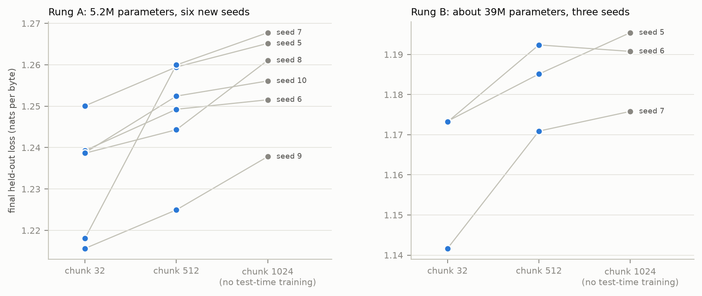

# Confirmatory pilot on the architectural class

Generated by `uv run python -m src.pilot.analyze_confirmatory` from `results/pilot_confirmatory.csv`
(run 2026-11-18T08:54:28Z, NVIDIA A10G, torch 2.15.0+cu132). Criteria: `docs/go_no_go_confirmatory.md`.

Criteria file hash stored in the result rows: `14f5fbb1d1e626f0`. Hash of the file now: `14f5fbb1d1e626f0`
(unchanged since the pilot was launched).

**Hypothesis fixed in advance.** At an equal number of training steps, a LaCT-style layer trained with chunk
length 32 reaches a lower held-out loss than the same model trained with chunk length 512.

## Rung A: verdict NO EFFECT

Six seeds never used before, 5.2M parameters, final held-out loss in nats per byte:

| Seed | chunk 32 | chunk 512 | chunk 1024 | chunk 512 minus chunk 32 |
|---|---|---|---|---|
| 5 | 1.2501 | 1.2595 | 1.2652 | +0.0094 |
| 6 | 1.2393 | 1.2493 | 1.2515 | +0.0100 |
| 7 | 1.2181 | 1.2600 | 1.2678 | +0.0419 |
| 8 | 1.2386 | 1.2443 | 1.2611 | +0.0057 |
| 9 | 1.2156 | 1.2250 | 1.2378 | +0.0093 |
| 10 | 1.2388 | 1.2524 | 1.2561 | +0.0137 |

Run-to-run floor, from the same seed run three times:

| Chunk | Seed | Final loss of each run | Span |
|---|---|---|---|
| 32 | 5 | 1.2501 1.2514 1.2506 | 0.0013 |
| 512 | 5 | 1.2595 1.2599 1.2599 | 0.0004 |

Floor used by the rule (the largest span): **0.0013**.

## Rung B: verdict CONSISTENT

About 39M parameters, three seeds:

| Seed | chunk 32 | chunk 512 | chunk 1024 | chunk 512 minus chunk 32 |
|---|---|---|---|---|
| 5 | 1.1734 | 1.1851 | 1.1954 | +0.0118 |
| 6 | 1.1732 | 1.1924 | 1.1908 | +0.0192 |
| 7 | 1.1417 | 1.1709 | 1.1758 | +0.0292 |

## The statistics

| Comparison (same seed) | Seeds | Mean | Std | t | Larger chunk worse in |
|---|---|---|---|---|---|
| Rung A, chunk 512 minus chunk 32 | 6 | +0.0150 | 0.0134 | +2.73 (needs more than 3.365) | 6 of 6 |
| Rung B, chunk 512 minus chunk 32 | 3 | +0.0201 | 0.0088 | +3.96 | 3 of 3 |
| Rung A, no test-time training minus chunk 32 (reported, not part of the decision) | 6 | +0.0232 | 0.0136 | +4.17 | 6 of 6 |
| Rung B, no test-time training minus chunk 32 (reported, not part of the decision) | 3 | +0.0246 | 0.0086 | +4.97 | 3 of 3 |

Rung A is an EFFECT if its t exceeds the one-sided 1% critical value and its mean exceeds the floor. Rung B is
CONSISTENT if the difference is positive in all three seeds and its mean exceeds the rung A floor.

## Decision on the science: NO-GO for the full paper

By the table fixed in advance: neither the precision branch nor the architectural branch shows an effect above noise; fall back to the shorter paper the roadmap describes.

## Outside the rule: what the verdict does not use

These are facts about the same data. They do not change the verdict above, which is the one the rule gives.

- **Sign.** The larger chunk is worse in 6 of 6 new seeds in rung A and 3 of 3 in rung B.
- **Size against the run-to-run floor.** The floor is 0.0013. The smallest of the 6 rung A differences is 0.0057, which is 4.2 floors; the mean is 11 floors. Reruns of this model are nearly reproducible, unlike the Gated DeltaNet kernels in the precision pilot.
- **Where t falls.** t = 2.73 with 5 degrees of freedom. It clears the one-sided 2.5% level and not the 1.0% level.
- **Why t is low.** One seed has a difference of +0.0419, about 4 times the others. It is in the predicted direction, but it inflates the standard deviation the t statistic divides by. Without it the other 5 give mean +0.0096, standard deviation 0.0028, t = 7.53. Dropping a seed after the fact is not allowed; this only explains the number.

*One dot per run; lines join the runs that share a seed.*

## What this does and does not say

- The comparison is at equal steps. Measured training throughput in tokens per second: width 256, chunk 32: 51k; width 256, chunk 512: 153k; width 256, chunk 1024: 204k; width 512, chunk 32: 12k; width 512, chunk 512: 36k; width 512, chunk 1024: 47k. Chunk 32 costs
  several times the compute of chunk 512, so a lower loss at equal steps is not a better model at equal
  wall-clock. That is the roadmap's separate wall-clock question, and these numbers say it is a real trade.
- Both rungs are far below the roadmap's pilot scale and far below the chunk lengths LaCT is designed for.
- One layer type, one dataset, one fixed attention window.
