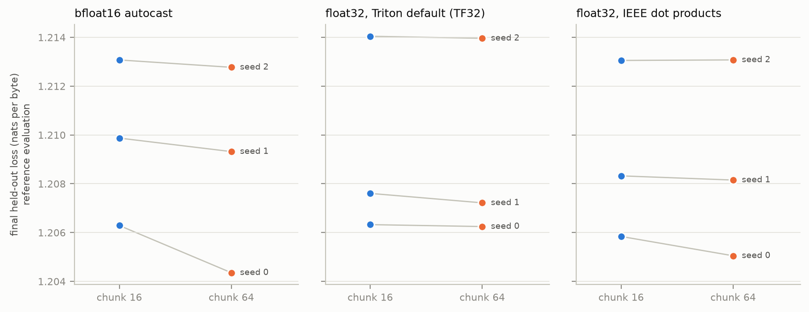

# Small precision pilot on the scheduling class

Generated by `uv run python -m src.pilot.analyze` from `results/pilot_precision.csv`
(run 2026-11-18T06:41:40Z, NVIDIA A10, torch 2.15.0+cu132). Criteria: `docs/go_no_go.md`, section 1.

Criteria file hash stored in the result rows: `4437729768457937`. Hash of the file now: `4437729768457937`
(unchanged since the pilot was launched).

## Setup

Byte-level language model on enwik8, 5,266,608 parameters (6 layers, width 256,
4 heads), mixing layer `chunk_gated_delta_rule` from flash-linear-attention at the pinned commit.
2000 steps of 32 windows of 1024 bytes. The seed fixes the initial weights and
the order of training windows, so runs with the same seed differ only in chunk length and arithmetic. The loss
is the held-out loss on 256 fixed validation windows, every model evaluated with the same reference
forward pass (float32, recurrent kernel). The largest difference between that and the loss under a model's own
training configuration is 1.3e-04 nats.

## Result

| Arithmetic | Kernel vs exact recurrence | Loss, chunk 16 | Loss, chunk 64 | d per seed (64 minus 16) | mean d | t | seed spread | Verdict |
|---|---|---|---|---|---|---|---|---|
| bfloat16 autocast | 6.4e-03 | 1.20974 | 1.20882 | -0.00193 -0.00055 -0.00030 | -0.00093 | -1.83 | 0.00384 | **NO EFFECT DETECTED** |
| float32, Triton default (TF32) | 1.9e-03 | 1.20933 | 1.20914 | -0.00008 -0.00039 -0.00008 | -0.00018 | -1.78 | 0.00417 | **NO EFFECT DETECTED** |
| float32, IEEE dot products | 3.3e-07 | 1.20907 | 1.20876 | -0.00079 -0.00017 +0.00002 | -0.00031 | -1.28 | 0.00386 | **NO EFFECT DETECTED** |

`d` is the loss at chunk 64 minus the loss at chunk 16 for the same seed. EFFECT requires |t| > 4.3 and
|mean d| larger than the seed spread. **bfloat16: NO EFFECT DETECTED.** This does **not** count toward go under the pre-registered rule.

*Final held-out loss per run. Grey lines join the two chunk lengths of one seed.*

## Run-to-run floor

The same configuration and seed run twice:

| Arithmetic | Chunk | Seed | Final loss of each rerun | Largest difference | Same final weight norm |
|---|---|---|---|---|---|
| bfloat16 autocast | 64 | 0 | 1.20436 1.20246 1.20620 (1 of 3 read from the run log, 4 d.p.) | 3.7e-03 | no |
| float32, Triton default (TF32) | 64 | 0 | 1.20625 1.20491 1.20340 (1 of 3 read from the run log, 4 d.p.) | 2.8e-03 | no |

Training with these kernels is not reproducible run to run: the same configuration and seed gives a final loss that differs by 2.8e-03 to 3.7e-03 nats. The largest chunk-length difference at a fixed seed is 1.9e-03 nats and the seed spread is 3.8e-03 to 4.2e-03. So a same-seed comparison between two chunk lengths is no tighter than a comparison between two reruns of one chunk length, and the chunk-length differences seen here are inside that floor.

## What this does and does not say

- It is one small model trained for minutes on one GPU. A null here does not bound a 160M-parameter model
  trained to convergence; it says the effect is not large at this scale.
- Three seeds give a coarse seed spread, and the test has low power: with three pairs only a shift several
  times the pair-to-pair scatter can pass.
- The three arithmetics are verified per run: the "Kernel vs exact recurrence" column is measured inside each
  training container before training starts.
